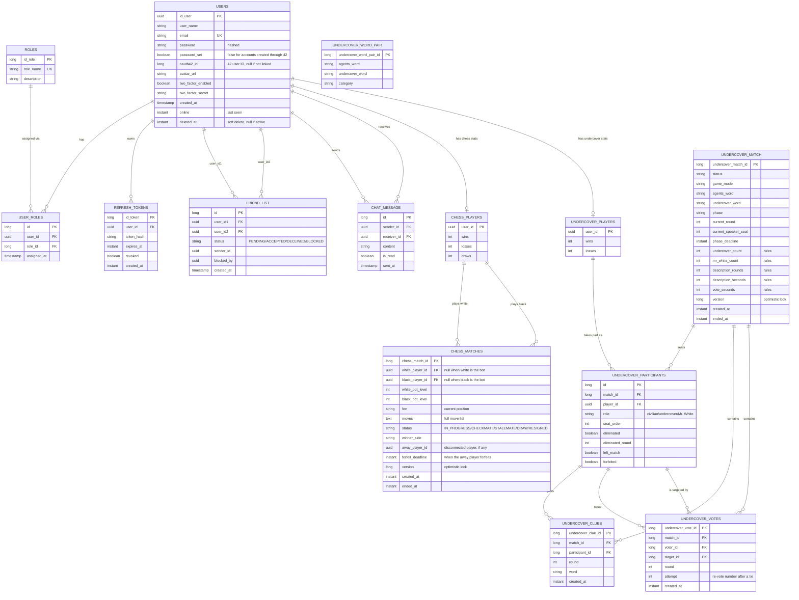

*This project has been created as part of the 42 curriculum by ebansse, rjacquet, iboutoui, yel-mang.*

# Transcendence

## Description

Transcendence is a full-stack, real-time multiplayer web application: a small game hub where friends meet, chat and play. Users can register, manage their profile and avatar, add and block friends, chat in real time, play chess against each other or against an AI opponent, and play Undercover, a social deduction word game for 3 to 20 players. Match history and statistics are tracked per account.

Key features:
- Secure user management: email/password authentication with hashed passwords, optional Two-Factor Authentication (TOTP), and login via 42 OAuth
- Single active session per account: logging in from a new device revokes any previous session, whose access token stops working immediately
- Brute-force protection: temporary lock-out after repeated failed logins or wrong 2FA codes
- Friend system with online presence, and a block system that never reveals a block suffered by the user (only blocks the user issued)
- Real-time chat and notifications (friend requests, game invitations) over WebSocket (STOMP/SockJS)
- A full chess platform: live matches, an AI opponent with its own evaluation engine and opening book, disconnect/reconnect handling, match history and per-player statistics
- Undercover: a multiplayer word game played in rooms of 3 to 20 players, with customizable rules
- Admin user management (view/edit/delete accounts, role management)
- HTTPS-only deployment behind nginx, fully containerized with Docker Compose

## Instructions

### Prerequisites

- [Docker](https://www.docker.com/products/docker-desktop/) and Docker Compose (`docker compose version`)
- A registered OAuth application on the [42 intra](https://profile.intra.42.fr/oauth/applications/new), if you want to test login via 42

Everything else (Java, Maven, Node, PostgreSQL) runs inside containers — you do not need them installed locally to run the project. Only the optional `make dev` workflow needs [Node.js](https://nodejs.org/) 22 on your machine.

### Setup

1. Copy the environment template and fill in real values:
   ```bash
   cp .env.example .env
   ```
   Required variables:
   | Variable | Description |
   |---|---|
   | `POSTGRES_DB` / `POSTGRES_USER` / `POSTGRES_PASSWORD` | PostgreSQL credentials |
   | `SPRING_DATASOURCE_URL` / `_USERNAME` / `_PASSWORD` | Backend datasource (local dev only — inside Docker the backend talks to the `db` service directly) |
   | `OAUTH42_CLIENT_ID` / `OAUTH42_CLIENT_SECRET` | From your 42 OAuth app |
   | `OAUTH42_REDIRECT_URI` | Must exactly match the Redirect URI registered on the 42 app — `https://localhost:8443/api/auth/42/callback` for local use |
   | `OAUTH42_FRONTEND_REDIRECT_URI` | Where the browser lands after a 42 login — `https://localhost:8443/` for local use |
   | `JWT_SECRET` | Signing key for access tokens. Generate one with `openssl rand -base64 32` — never reuse the example value |
   | `FRONTEND_ORIGIN` | Origin allowed to open the WebSocket connection — `https://localhost:8443` for local use |
   | `ADMIN_EMAIL` / `ADMIN_USERNAME` / `ADMIN_PASSWORD` | Administrator account created at startup if no account has this email yet (username: 3 to 20 letters, digits, `_` or `-`; password: at least 6 characters). The account with this email is given the `ADMIN` role at every startup. Leave the three empty to create none — but then no administrator exists, since only an administrator can promote another account |

2. Launch everything with a single command:
   ```bash
   make
   ```
   This builds and starts three containers: `nginx` (TLS termination + reverse proxy + serves the built frontend), `backend` (Spring Boot), and `db` (PostgreSQL).

3. Open **https://localhost:8443/** in your browser (nginx listens on 443 inside its container, published on port `8443` of the host). The TLS certificate is self-signed for local use, so the browser will warn you once — accept it to continue.

### Other useful commands

| Command | Effect |
|---|---|
| `make` / `make up` | Build (if needed) and start the stack |
| `make down` | Stop the stack |
| `make re` | Restart everything (`down` + `up --build`) — needed after a code change or a `.env` change, since `docker compose restart` alone does **not** re-read `.env` |
| `make logs` | Follow logs from all containers |
| `make ps` | List running containers |
| `make dev` | Development mode: starts only `db` and `backend` in Docker, with `compose.dev.yaml` publishing the backend on `127.0.0.1:8080`, then runs the frontend with the Vite dev server (hot reload), which proxies API calls to it. Requires Node.js locally and a first `npm install` in `front/` |
| `make clean` / `make fclean` | Tear down and remove images (`fclean` also removes the database volume — this deletes all data) |

### Testing the API

You can test the backend endpoints directly with Postman (disable "SSL certificate verification" in its settings, since the certificate is self-signed). Example, once the stack is running:
```
POST https://localhost:8443/api/auth/register
Content-Type: application/json

{
  "userName": "john_doe",
  "email": "john@example.com",
  "password": "password123",
  "confirmedPassword": "password123"
}
```
Login sets `access_token`/`refresh_token` as `HttpOnly`, `Secure`, `SameSite=strict` cookies — Postman's cookie jar handles them automatically across requests to the same domain.

## Resources

- [Spring Boot reference documentation](https://docs.spring.io/spring-boot/index.html)
- [Spring Security reference documentation](https://docs.spring.io/spring-security/reference/index.html)
- [Spring Data JPA reference documentation](https://docs.spring.io/spring-data/jpa/reference/index.html)
- [JJWT](https://github.com/jwtk/jjwt) — JWT issuing/parsing library used for access tokens
- [Chess Programming Wiki](https://www.chessprogramming.org/) — piece-square tables, board evaluation and opening book concepts used by the AI opponent
- [42 API documentation](https://api.intra.42.fr/apidoc) — OAuth2 authorization code flow
- [React documentation](https://react.dev/)
- [nginx documentation](https://nginx.org/en/docs/) — reverse proxy and TLS termination configuration

**Use of AI:** Claude (Anthropic) was used by all team members throughout development, across the whole project (backend, frontend and deployment), but mainly as a learning and support tool rather than to write core logic. The actual implementation code was written by the team members, with Claude used for explaining concepts, writing comments and Javadoc, reviewing code for bugs before it was committed, and running end-to-end tests/debugging — including live HTTP requests against the running Docker stack, and diagnosing an environment issue. No AI-generated logic was copy-pasted without being understood first.

## Team Information

| Member | Role(s) | Responsibilities |
|---|---|---|
| iboutoui | Tech Lead / Project Manager / Developer | Backend architecture (hexagonal layout for the game modules), authentication core (register, JWT, refresh tokens, logout, security config), friends/block system, chat backend, chess engine and AI opponent, Undercover game |
| yel-mang | Product Owner / Developer | GitHub repository and ticket (TRA-XX) organization, most of the frontend (chess board, notifications, profile, admin page, design), 2FA, Docker Compose + nginx HTTPS deployment |
| ebansse | Developer | User profile and avatar upload, 42 OAuth login, account soft-deletion, single active session, auth hardening for production (secure cookies, JWT secret, WebSocket CORS), block privacy on the friend list |
| rjacquet | Developer | Frontend register page, SPA routing and game hub layout, quick chat and chat history UI, sidebar, Privacy Policy / Terms of Service pages |

## Project Management

- **Task organization:** tasks were tracked and distributed with Jira — one ticket per feature (`TRA-XX` IDs), each assigned to a team member
- **Version control:** GitHub, with one branch per Jira ticket named after it (e.g. `TRA-24-chess-ai-opponent-bot`)
- **Communication channel:** Discord
- **Meeting cadence:** weekly syncs
- **Code review:** feature branches are merged into `main` through GitHub Pull Requests

## Technical Stack

**Frontend**
- React 19 + TypeScript, built with Vite
- React Router for SPA navigation
- `chess.js` for client-side chess rules
- `@stomp/stompjs` + `sockjs-client` for the WebSocket/STOMP connection (chat, notifications, live chess moves, Undercover, presence)

**Backend**
- Spring Boot 4.1 (Java 21)
- Spring Security — stateless, JWT-based authentication (no server-side session), a custom filter validates the access token cookie on every request
- Spring Data JPA / Hibernate — ORM over PostgreSQL
- Spring WebSocket (STOMP over SockJS) — chat, live chess moves, presence broadcasting
- `jjwt` — JWT issuing and verification
- `totp` — Two-Factor Authentication code generation/verification
- `jchessify` (the `chesslib` Java chess library) — server-side move generation and validation, used by the chess referee and the AI opponent
- `dotenv-java` — loads `.env` for local (non-Docker) runs

**Database**
- PostgreSQL 17 — relational database, chosen for the strongly relational nature of the data (users ↔ roles, users ↔ friend relationships, users ↔ chess matches, Undercover matches ↔ participants ↔ clues and votes) and Spring Data JPA's first-class support for it.

**Deployment**
- Docker Compose orchestrating three services: `nginx` (TLS termination, reverse proxy, serves the built frontend), `backend`, `db`
- nginx is the single public entry point (`https://localhost:8443/`: container port 443 published on host port 8443), so browser cookies can safely use the `Secure` flag
- With `make`, neither the backend nor the database publishes a port: the backend can only be reached through nginx, over HTTPS. Its HTTP port 8080 is published, on `127.0.0.1` only, by the separate `compose.dev.yaml` file that `make dev` adds for local development
- `nginx` proxies `/api/*` and `/ws` to the backend, and serves the compiled frontend for every other route (client-side routing handled by React Router)

## Database Schema



`FRIEND_LIST` stores a single row per pair of users (the lower UUID always in `user_id1`), with `status` covering friend requests, acceptance, decline, and blocks — `blocked_by` records which side blocked the other, so a suffered block is never exposed to the blocked user's own `GET /friend-list` response.

`CHESS_MATCHES` stores the current position (`fen`) and the full move list; a side played by the bot has no player row, only a bot level. `away_player_id` and `forfeit_deadline` persist the disconnection countdown so it survives a backend restart.

The Undercover tables store one row per match, one per seated player (`UNDERCOVER_PARTICIPANTS`, with their secret role), and every clue and vote, with unique constraints allowing one clue per player per round and one vote per player per ballot. `UNDERCOVER_WORD_PAIR` is the seeded word bank, not linked to any match. Chess invitations and Undercover rooms (before the match starts) are short-lived and kept in memory, not in the database.

## Features List

| Feature | Description | Contributor(s) |
|---|---|---|
| Registration / Login | Email+password auth, hashed passwords, JWT access + refresh tokens as HttpOnly cookies | iboutoui (core), ebansse (production hardening), rjacquet (register page) |
| Single active session | A new login revokes the previous session: its refresh token, and the access tokens issued with it | ebansse |
| 2FA (TOTP) | Optional authenticator-app based two-factor authentication, brute-force protection | yel-mang |
| 42 OAuth login | "Sign in with 42", account auto-created on first login, link an existing account to 42 | ebansse (backend), yel-mang (frontend, account linking) |
| Profile management | View/update username and email, avatar upload with a default avatar, account deletion | ebansse (backend), yel-mang / rjacquet (profile page) |
| Friend system | Send/accept/decline requests, remove friends, online presence | iboutoui (backend, presence), yel-mang (frontend) |
| Block system | Block/unblock, direction-aware (a suffered block is never exposed) | iboutoui, ebansse (suffered-block privacy), yel-mang (unblock UI) |
| Real-time chat | WebSocket-based messaging, chat history | iboutoui (backend), rjacquet (quick chat UI + history) |
| Real-time notifications | Toasts + persistent inbox for friend requests and game invitations | yel-mang |
| Chess — live matches | Real-time chess between two players, full rule enforcement, invitations, pawn promotion | iboutoui (backend), yel-mang (board UI, invitations, live stream) |
| Chess — AI opponent | Bot with board evaluation, opening book and piece-square tables | iboutoui |
| Chess — reconnection | Handles disconnects/reconnects during a live match | iboutoui |
| Chess — stats & history | Per-player win/loss/draw record and match history | iboutoui |
| Undercover | Multiplayer social deduction word game (rooms, word pairs by category, role dealing incl. Mr. White, votes) | iboutoui |
| Admin panel | View/edit/delete any account, role management | yel-mang |
| Privacy Policy / Terms of Service | Accessible legal pages | rjacquet |
| Deployment | Docker Compose, nginx reverse proxy with HTTPS, Makefile | yel-mang |

## Modules

| Category | Module | Type | Points |
|---|---|---|---|
| Web | Frontend + backend frameworks (React + Spring Boot) | Major | 2 |
| Web | Real-time features (WebSocket: chat, chess, presence) | Major | 2 |
| Web | User interaction (chat, profile, friends) | Major | 2 |
| Web | ORM (Spring Data JPA / Hibernate) | Minor | 1 |
| User Management | Standard user management (profile, avatar, friends, presence) | Major | 2 |
| User Management | Remote authentication via 42 OAuth 2.0 | Minor | 1 |
| User Management | Advanced permissions system (admin CRUD, roles) | Major | 2 |
| User Management | 2FA | Minor | 1 |
| User Management | Game statistics & match history (chess) | Minor | 1 |
| Artificial Intelligence | AI opponent for chess | Major | 2 |
| Gaming and UX | Complete web-based game (chess) | Major | 2 |
| Gaming and UX | Remote players (disconnect/reconnect handling) | Major | 2 |
| Gaming and UX | Multiplayer game, more than two players (Undercover, 3 to 20 players) | Major | 2 |
| Gaming and UX | Game customization options (Undercover room rules and words) | Minor | 1 |
| **Total** | | | **23** |

### Chess

Four of the modules above are built on the chess game. We chose chess because its rules are unambiguous and well documented, which let us focus on what the subject actually evaluates: a server-authoritative real-time game, clean handling of network failures, and an AI that can be explained.

- **Complete web-based game (Major)** — *iboutoui (backend), yel-mang (frontend)*. Two players play a live match from an invitation sent to a friend, choosing white, black or a random colour; pending invitations expire automatically. The server is the only referee: every move received is checked against the legal moves of the current position with `chesslib` before being applied, so a modified client cannot cheat. The position (FEN) and the full move list are stored on the match row, protected by an optimistic lock against two simultaneous moves. The server detects every ending: checkmate, stalemate, draw (repetition, fifty-move rule, insufficient material) and resignation. On the client, `chess.js` mirrors the rules to show legal moves instantly, with a promotion dialog and the list of captured pieces with the material score.
- **Remote players (Major)** — *iboutoui (backend), yel-mang (socket client)*. Each player is on their own computer; moves travel over STOMP/SockJS through nginx and are pushed to both players on a private per-user channel. When a player's connection drops, the match is not lost: a 60-second grace period starts (configurable), during which the client reconnects automatically (retry every 3 seconds) and gets the current state of the match back from the server. If the player returns in time the countdown is cancelled; otherwise the match is forfeited and the opponent is told they won. The deadline is written on the match row rather than only held in a timer, so a backend restart in the middle of a grace period does not leave a match stuck forever: countdowns are re-armed at startup, and a periodic sweep settles any match that was missed.
- **AI opponent (Major)** — *iboutoui (engine), yel-mang and iboutoui (frontend)*. The bot runs on the server and can play either colour. It picks its move with a negamax search with alpha-beta pruning, scoring positions with material values and piece-square tables (with separate tables for the endgame). For the first moves it plays from an opening book built from a file of real games, choosing among the moves played there in proportion to how often they were played. There are 10 difficulty levels, which change the search depth (1 to 4 plies) and how human the bot is: random noise is added to its evaluation, and it has a chance to play a random move, from 30% at level 1 down to none at level 10. It therefore makes mistakes like a human would, can be beaten at low levels, and wins regularly at high levels.
- **Game statistics & match history (Minor)** — *iboutoui (backend), yel-mang (Stats page)*. Each player's wins, losses and draws are updated whenever a match ends, whatever the ending (including a forfeit after a disconnection). The Stats page shows these totals and the list of finished matches, most recent first, with the opponent, the result, the date and the duration.

### Undercover

Undercover is a real-time social deduction word game played by 3 to 20 players in the same room. Each player secretly receives a word: civilians share one word, undercovers get a close but different one, and Mr. White gets none. Players take turns giving a one-word clue, then vote to eliminate the player they suspect; an eliminated Mr. White can still win by guessing the civilians' word.

- **Multiplayer (3+ players):** rooms are created and joined by code, and a match can start once at least 3 players are in. Every phase (clues, votes, Mr. White's guess) is driven by a server-side clock and broadcast to all clients over STOMP, with a private per-player channel so each player only receives their own word and role. Turn order, vote tally, tie-breaks (re-votes) and win conditions are resolved on the server, so all clients stay in sync and no player can read another player's secret state.
- **Game customization:** the host picks a preset game mode or a custom one, where they set the number of undercovers and Mr. Whites, the number of clue rounds, the duration of each phase, the number of tie re-votes and whether undercovers win on parity. They also choose the word categories, or provide their own word pairs. Every setting has a default value, so a room can be started without changing anything.
- **History and statistics:** matches, participants, clues and votes are persisted, and each player can view their own Undercover statistics.

## Individual Contributions

**iboutoui** — Laid the backend foundation: user registration, role model, JWT access/refresh tokens, login/logout and the Spring Security configuration. Built the friend system (requests, accept/decline, remove, block/unblock) and the chat backend (messages, history, read status). Designed the chess module in a hexagonal architecture: game logic, invitation system with automatic expiry, resign, stats recording, match history, disconnect handling, and the AI opponent (piece-square tables, piece values, repetition avoidance, opening book). Also implemented the Undercover game (rooms, word pairs by category, role dealing, votes, Mr. White).

**yel-mang** — Owned most of the frontend: persistent WebSocket connection across pages, chess board with `chess.js`, game invitations and live game streaming, pawn promotion dialog, real-time notifications (toasts + inbox), profile and admin pages, and the final arcade-style design. Implemented 2FA (TOTP) end to end, with brute-force protection (lock-out after repeated wrong codes or failed logins) and integration with the 42 OAuth callback. Closed an account-takeover risk by matching 42 logins on the 42 user ID instead of the email, adding a "link my 42 account" flow. Containerized every service and set up nginx as the HTTPS reverse proxy, plus the Makefile.

**ebansse** — Implemented user profile retrieval and update, avatar upload (file validation, storage, served as static files, default avatar), 42 OAuth2 login, and soft-deletion of accounts. Enforced a single active session per user: every login path (password, 2FA, 42 OAuth, refresh rotation) revokes the previous session, and each access token names its session so that it is refused as soon as that session is revoked. Hid blocks suffered by a user from their own friend list. Hardened the app for production: `Secure` cookies, JWT secret moved out of the repository, WebSocket CORS restricted to the frontend origin.

**rjacquet** — Built the frontend register page, SPA routing and the game hub layout, the quick chat with message history, the sidebar and parts of the profile page, and the Privacy Policy / Terms of Service pages.
