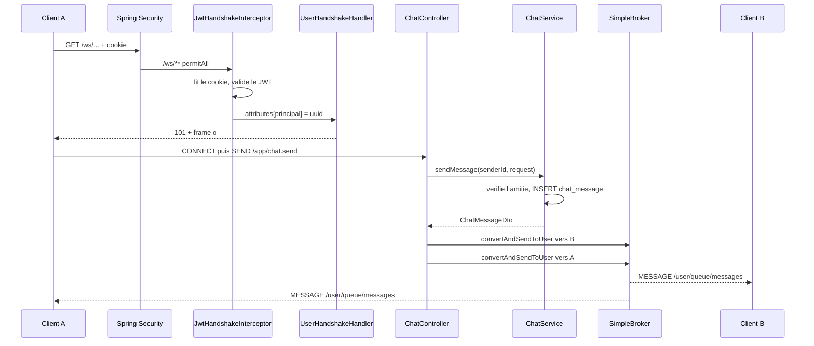

# WebSocket / STOMP — fonctionnement détaillé

Ce document décrit **uniquement la couche temps réel** : du handshake jusqu'à la
réception d'un message par le destinataire. La logique métier (amitié, persistance)
n'est évoquée que comme point de passage.

---

## 1. Les couches empilées

Une connexion de chat n'est pas un seul protocole mais quatre, emboîtés :

```
┌─────────────────────────────────────────────┐
│ STOMP      commandes CONNECT / SUBSCRIBE /  │  ← ce que ton code manipule
│            SEND / MESSAGE / ERROR           │
├─────────────────────────────────────────────┤
│ SockJS     encapsulation JSON + fallbacks   │  ← ajouté par .withSockJS()
├─────────────────────────────────────────────┤
│ WebSocket  tuyau bidirectionnel permanent   │  ← RFC 6455
├─────────────────────────────────────────────┤
│ HTTP       uniquement pour le handshake     │  ← puis abandonné
└─────────────────────────────────────────────┘
```

**Pourquoi STOMP et pas du WebSocket brut ?** Le WebSocket transporte des octets,
sans notion de destination ni d'abonnement. STOMP ajoute un adressage
(`/queue/messages`), un modèle publier/s'abonner et des en-têtes — c'est ce qui
permet à Spring de router un message vers une méthode annotée, exactement comme
`@GetMapping` le fait en HTTP.

**Pourquoi SockJS ?** Certains proxys coupent les connexions WebSocket. SockJS
négocie le meilleur transport disponible et retombe sur du HTTP long-polling si
nécessaire. Conséquence importante : l'URL réelle n'est pas `/ws` mais
`/ws/{server}/{session}/{transport}`.

---

## 2. Carte des fichiers

| Fichier | Rôle |
|---|---|
| `config/WebSocketConfig.java` | Déclare l'endpoint et le broker |
| `config/JwtHandshakeInterceptor.java` | Authentifie le handshake |
| `config/StompPrincipalConfig.java` | Attache l'identité à la session |
| `config/SecurityConfig.java` | Laisse passer `/ws/**` |
| `controller/ChatController.java` | Reçoit, diffuse, gère les erreurs |
| `services/ChatService.java` | Vérifie et persiste |

---

## 3. La configuration — ce qui est mis en place au démarrage

### `WebSocketConfig.registerStompEndpoints()`

```java
registry.addEndpoint("/ws")
        .setHandshakeHandler(new StompPrincipalConfig.UserHandshakeHandler())
        .addInterceptors(jwtHandshakeInterceptor)
        .setAllowedOriginPatterns("*")
        .withSockJS();
```

| Appel | Effet |
|---|---|
| `addEndpoint("/ws")` | URL de base du handshake |
| `setHandshakeHandler(...)` | **qui** est l'utilisateur de la session |
| `addInterceptors(...)` | **si** la connexion est acceptée |
| `setAllowedOriginPatterns("*")` | quels sites peuvent se connecter |
| `withSockJS()` | active la négociation et les fallbacks |

L'ordre d'écriture de `setHandshakeHandler` et `addInterceptors` n'a pas
d'importance : à l'exécution, **l'interceptor s'exécute toujours avant le handler**.

### `WebSocketConfig.configureMessageBroker()`

```java
registry.enableSimpleBroker("/topic", "/queue");
registry.setApplicationDestinationPrefixes("/app");
registry.setUserDestinationPrefix("/user");
```

Trois préfixes, trois significations très différentes :

| Préfixe | Direction | Signification |
|---|---|---|
| `/app` | client → serveur | route vers une méthode `@MessageMapping` |
| `/queue`, `/topic` | serveur → client | géré par le broker, distribué aux abonnés |
| `/user` | serveur → **un** client | résolu vers les sessions d'un utilisateur précis |

`enableSimpleBroker` active le broker **en mémoire**. Il ne stocke rien : un message
émis alors que personne n'est abonné est perdu. C'est la raison d'être de la table
`chat_message` et du futur endpoint d'historique.

---

## 4. Phase 1 — Le handshake

### 4.1 Négociation SockJS

Le client commence par interroger les capacités du serveur :

```
GET /ws/info
→ 200 {"entropy":1501523008,"origins":["*:*"],"cookie_needed":true,"websocket":true}
```

- `websocket: true` → le transport natif est disponible, pas de fallback nécessaire
- `entropy` → aléa servant au client à fabriquer un identifiant de session

⚠️ Cette requête **ne passe pas par `JwtHandshakeInterceptor`**. Elle répond `200`
même sans authentification. Un `200` ici ne prouve donc rien sur l'authentification.

### 4.2 La vraie requête de handshake

```
GET /ws/000/postman1/websocket HTTP/1.1
Upgrade: websocket
Connection: Upgrade
Cookie: access_token=eyJhbGci...     ← envoyé automatiquement par le navigateur
```

**C'est une requête HTTP ordinaire.** Elle traverse toute la chaîne Spring Security
avant d'atteindre le code WebSocket. D'où la règle indispensable :

```java
.requestMatchers("/ws/**").permitAll()
```

Sans elle, le `.anyRequest().denyAll()` en fin de chaîne renvoie `403` et **aucun
code WebSocket n'est jamais atteint** — pas même un log.

`permitAll()` ne signifie pas « ouvert à tous » mais « Spring Security ne décide pas
ici » : l'authentification est déléguée à l'interceptor.

Le motif `/ws/**` couvre tout le sous-arbre, car SockJS utilise plusieurs URL
(`/ws/info`, `/ws/{server}/{session}/websocket`,
`/ws/{server}/{session}/xhr_streaming`…).

### 4.3 `JwtHandshakeInterceptor.beforeHandshake()`

Premier point de contrôle. Sa valeur de retour décide de tout : `true` accepte la
connexion, `false` la refuse.

```java
if (!(request instanceof ServletServerHttpRequest servletRequest)) {
    return false;                                    // ① garde
}
String token = extractAccessTokenFromCookies(servletRequest.getServletRequest());
if (token == null || !jwtService.isTokenValid(token)) {
    response.setStatusCode(HttpStatus.UNAUTHORIZED);  // ② refus explicite
    return false;
}
String userId = jwtService.extractUserId(token);
Principal principal = () -> userId;                   // ③ identité
attributes.put(PRINCIPAL_ATTRIBUTE, principal);       // ④ dépôt
return true;
```

**① Le garde.** Refuser plutôt que continuer : une requête non-servlet ne permet pas
de lire les cookies, la connexion s'ouvrirait donc sans identité.

**② Pourquoi lire un cookie et pas un paramètre d'URL.** L'`access_token` est posé en
`httpOnly` : JavaScript ne peut pas le lire, donc le front ne peut pas l'écrire dans
l'URL. Et un token dans une URL finirait dans les logs d'accès, l'historique du
navigateur et l'en-tête `Referer`. Le cookie, lui, est envoyé automatiquement
puisque le handshake est une requête HTTP.

**③ La lambda.** `Principal` est une interface à méthode unique (`getName()`), donc
`() -> userId` en est une implémentation valide. **Le nom du Principal est l'UUID de
l'utilisateur** — c'est cette valeur qui servira d'adresse de routage.

**④ Le dépôt.** `attributes` est une `Map` qui devient les *attributs de session
WebSocket* : un sac de données qui survit à toute la durée de la connexion.

### 4.4 `UserHandshakeHandler.determineUser()`

Second point de contrôle, appelé juste après :

```java
return (Principal) attributes.get(JwtHandshakeInterceptor.PRINCIPAL_ATTRIBUTE);
```

Spring appelle cette méthode pour savoir **à qui appartient la session**. Le
`DefaultHandshakeHandler` d'origine renvoie l'utilisateur Spring Security de la
requête HTTP — donc `null` ici, puisque `/ws/**` est en `permitAll()`. On l'écrase
pour récupérer ce que l'interceptor a déposé.

> **Le passage de témoin en deux temps est le mécanisme central.**
> L'interceptor *dépose*, le handler *ramasse*. Si le handler n'est pas branché
> (`setHandshakeHandler` absent), tout semble fonctionner : la connexion s'ouvre, les
> messages partent — mais `Principal` est `null` dans les contrôleurs et
> `convertAndSendToUser` n'atteint personne, **sans lever la moindre erreur**.

### 4.5 Pourquoi mémoriser l'identité une fois pour toutes

En REST, chaque requête porte son cookie et `JWTAuthenticationFilter` ré-authentifie
à chaque appel. En WebSocket, la connexion s'ouvre une fois et vit des heures. Les
frames STOMP qui circulent ensuite **ne sont pas des requêtes HTTP** : pas de cookie,
pas de filtre de sécurité. L'identité doit donc être capturée au handshake et
rattachée à la session.

Conséquence : **un token expiré n'interrompt pas une session déjà ouverte.** La
validation n'a lieu qu'à la connexion.

### 4.6 Fin du handshake

```
← 101 Switching Protocols
← o                          (frame « open » de SockJS)
```

À partir de là, plus de HTTP : le tuyau est bidirectionnel et permanent.

---

## 5. Phase 2 — La session STOMP

Le tuyau est ouvert, mais STOMP n'est pas encore établi. C'est un protocole **à
état** : tant que `CONNECT` n'a pas eu lieu, tout autre frame est ignoré.

### 5.1 CONNECT / CONNECTED

```
→ CONNECT
  accept-version:1.2
  heart-beat:0,0

← CONNECTED
  version:1.2
  user-name:00715f71-428c-4670-8da2-f056872b15c7
```

L'en-tête **`user-name` n'apparaît que si un `Principal` est attaché**. C'est le
moyen le plus rapide de vérifier que `determineUser()` fonctionne.

### 5.2 SUBSCRIBE et la résolution `/user`

```
→ SUBSCRIBE
  id:sub-0
  destination:/user/queue/messages
```

Le client s'abonne à `/user/queue/messages` — **sans jamais nommer d'utilisateur**.
Le `/user` signifie « ma file personnelle ».

En coulisses, `UserDestinationMessageHandler` intercepte l'abonnement et le réécrit
en une destination propre à la session :

```
/user/queue/messages   →   /queue/messages-user<sessionId>
```

C'est ce qui isole les utilisateurs les uns des autres : deux personnes abonnées à la
même chaîne `/user/queue/messages` reçoivent en réalité deux flux distincts.

---

## 6. Phase 3 — De l'envoi à la réception

### 6.1 Le frame SEND

```
→ SEND
  destination:/app/chat.send
  content-type:application/json

  {"receiverId":"c92f8b2a-...","content":"salut"}
```

Le préfixe `/app` correspond à `setApplicationDestinationPrefixes("/app")` : il
signifie « ceci n'est pas pour le broker, c'est pour du code applicatif ».

### 6.2 Le trajet côté serveur

```
StompSubProtocolHandler            décode les octets en frame STOMP
        ↓
clientInboundChannel               canal des messages entrants
        ↓
SimpAnnotationMethodMessageHandler retire /app → cherche @MessageMapping("/chat.send")
        ↓
PayloadMethodArgumentResolver      Jackson : JSON → ChatMessageRequestDto
        ↓                          @Valid : @NotBlank, @Size(max = 1000), @NotNull
ChatController.send(...)
```

### 6.3 `ChatController.send()`

```java
UUID senderId = UUID.fromString(principal.getName());
ChatMessageDto message = chatService.sendMessage(senderId, request);

messagingTemplate.convertAndSendToUser(
        message.getReceiverId().toString(), MESSAGE_DESTINATION, message);
messagingTemplate.convertAndSendToUser(
        message.getSenderId().toString(), MESSAGE_DESTINATION, message);
```

**L'expéditeur vient du `Principal`, jamais du payload.** C'est la garantie de
sécurité du système : si le client fournissait son propre `senderId`, n'importe qui
pourrait écrire au nom d'un autre. C'est pourquoi `ChatMessageRequestDto` ne contient
que `receiverId` et `content`.

**Pourquoi deux envois.** Le premier livre le message au destinataire. Le second le
renvoie à l'expéditeur : ses autres onglets restent synchronisés, et il reçoit la
version serveur — avec le véritable `id` et le véritable `sentAt` — ce qui lui permet
de remplacer le message affiché en optimiste.

**Pourquoi pas un simple `return`.** Une méthode `@MessageMapping` annotée
`@SendToUser` ne répond qu'à **l'émetteur**. Ici la cible principale est le
destinataire, d'où le `SimpMessagingTemplate` qui laisse choisir librement.

### 6.4 `convertAndSendToUser(...)` en détail

| Argument | Valeur | Rôle |
|---|---|---|
| 1 | `"c92f8b2a-..."` | **le nom du `Principal`** de la cible |
| 2 | `"/queue/messages"` | suffixe ; Spring préfixe en `/user/...` |
| 3 | `message` | l'objet, sérialisé en JSON par Jackson |

Asymétrie à retenir : le client s'abonne à `/user/queue/messages`, le serveur écrit
sur `/queue/messages`. C'est la même destination vue des deux côtés.

⚠️ Le premier argument doit correspondre **exactement** au nom du Principal.
`UUID.toString()` produit des minuscules ; toute différence de casse fait échouer le
routage **en silence**.

### 6.5 La fin du trajet

```
convertAndSendToUser → destination /user/{uuid}/queue/messages
        ↓
UserDestinationMessageHandler    résout vers /queue/messages-user<sessionId>
        ↓                        pour CHAQUE session ouverte de cet utilisateur
SimpleBrokerMessageHandler       cherche les abonnements correspondants
        ↓
clientOutboundChannel
        ↓
StompSubProtocolHandler          encode en frame MESSAGE
        ↓
← MESSAGE
  subscription:sub-0
  destination:/user/queue/messages

  {"id":42,"senderId":"...","content":"salut","sentAt":"...","isRead":false}
```

Un utilisateur connecté sur trois appareils reçoit le message sur les trois : la
résolution produit une destination par session.

**Si personne n'est abonné, le message est perdu** — sans erreur. Le broker en
mémoire ne conserve rien. Seule la ligne en base subsiste.

### 6.6 Vue d'ensemble



---

## 7. Les trois moments d'échec

STOMP **n'a pas de code de statut**. Une exception non gérée est journalisée côté
serveur et le client ne reçoit rien : il croit que son message est passé. D'où trois
gestionnaires dans `ChatController`.

| Moment | Exception | Cause typique |
|---|---|---|
| Lecture du JSON | `MessageConversionException` | UUID malformé, JSON invalide |
| Validation `@Valid` | `MethodArgumentNotValidException` | contenu vide, > 1000 caractères |
| Logique métier | `IllegalArgumentException` | non amis, destinataire inconnu |

Les deux premières surviennent **avant** l'entrée dans la méthode, pendant la
résolution des arguments — c'est pourquoi elles ne peuvent pas être attrapées par un
`try/catch` à l'intérieur de `send()`.

Tous renvoient `{"error": "..."}` sur `/user/queue/errors`, la même forme que les
réponses REST du projet. **Le client doit s'abonner aux deux destinations :**

```
/user/queue/messages
/user/queue/errors
```

---

## 8. Récapitulatif des fonctions

| Fonction | Quand | Rôle |
|---|---|---|
| `registerStompEndpoints()` | démarrage | déclare `/ws`, branche interceptor et handler |
| `configureMessageBroker()` | démarrage | déclare les préfixes `/app`, `/queue`, `/user` |
| `beforeHandshake()` | 1× à la connexion | valide le JWT, dépose le `Principal` |
| `extractAccessTokenFromCookies()` | appelée par la précédente | lit le cookie `access_token` |
| `determineUser()` | 1× après l'interceptor | rattache le `Principal` à la session |
| `afterHandshake()` | 1× après le handshake | inutilisée (crochet de journalisation) |
| `send()` | à chaque message | route, persiste, diffuse |
| `sendMessage()` | appelée par `send()` | vérifie l'amitié, écrit en base |
| `convertAndSendToUser()` | 2× par message | pousse vers une file personnelle |
| `handleRejectedMessage()` | sur refus métier | renvoie l'erreur à l'émetteur |
| `handleInvalidPayload()` | sur échec `@Valid` | idem, avec le champ fautif |
| `handleUnreadablePayload()` | sur échec Jackson | idem, message générique |

---

## 9. Tester à la main

SockJS encapsule les frames STOMP dans un tableau JSON, ce qui rend le test possible
dans n'importe quel client WebSocket : les caractères spéciaux de STOMP (retours à la
ligne, octet NUL final) s'écrivent avec les échappements JSON `\n` et `\u0000`, et
c'est le serveur qui les reconstitue.

URL — **l'identifiant de session doit être neuf à chaque connexion** :

```
ws://localhost:8080/ws/000/<session-unique>/websocket
```

En-tête : `Cookie: access_token=<jwt>`

```
1. ["CONNECT\naccept-version:1.2\nheart-beat:0,0\n\n\u0000"]
2. ["SUBSCRIBE\nid:sub-0\ndestination:/user/queue/messages\n\n\u0000"]
3. ["SUBSCRIBE\nid:sub-1\ndestination:/user/queue/errors\n\n\u0000"]
4. ["SEND\ndestination:/app/chat.send\ncontent-type:application/json\n\n{\"receiverId\":\"<uuid>\",\"content\":\"salut\"}\u0000"]
```

Réponses : `o` à l'ouverture, `a[...]` pour les messages, `h` pour les battements de
cœur, `c[...]` à la fermeture.

---

## 10. Pièges connus

**Identifiant de session unique.** Réutiliser un identifiant déjà employé donne un
`404` si la session appartient à un autre utilisateur (protection contre le
détournement de session), ou un `Unknown session` si la session fantôme appartient au
même. Le vrai client SockJS tire un identifiant aléatoire à chaque fois ; seul le
test manuel expose le problème.

**Cookie et même origine.** Le cookie est en `sameSite=strict`. En développement, le
front tourne sur `:5173` et le backend sur `:8080` : sans proxy, le cookie n'est pas
envoyé et le handshake échoue en `401`. Il faut donc dans `vite.config.ts` :

```ts
'/ws': { target: 'http://localhost:8080', changeOrigin: true, ws: true }
```

Le `ws: true` est indispensable — sans lui, Vite ne relaie pas le changement de
protocole.

**Token de 15 minutes.** Le handshake échoue en `401` si l'`access_token` a expiré.
Le client doit appeler `/api/auth/refresh-token` puis reconnecter. Une session déjà
ouverte, elle, n'est jamais interrompue.

**Origines autorisées.** `setAllowedOriginPatterns("*")` accepte les connexions
depuis n'importe quel site. À restreindre à l'origine du front avant la mise en
production.

**Aucune persistance dans le broker.** Un message émis pendant que le destinataire
est hors ligne n'est jamais rejoué. La table `chat_message` et l'historique REST sont
la seule mémoire du système.
